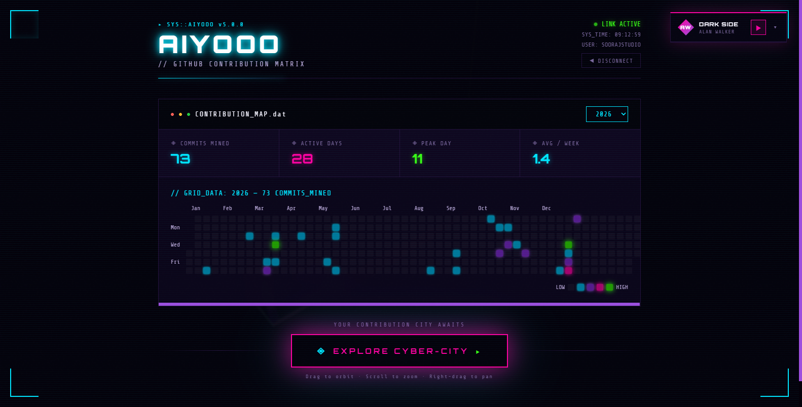
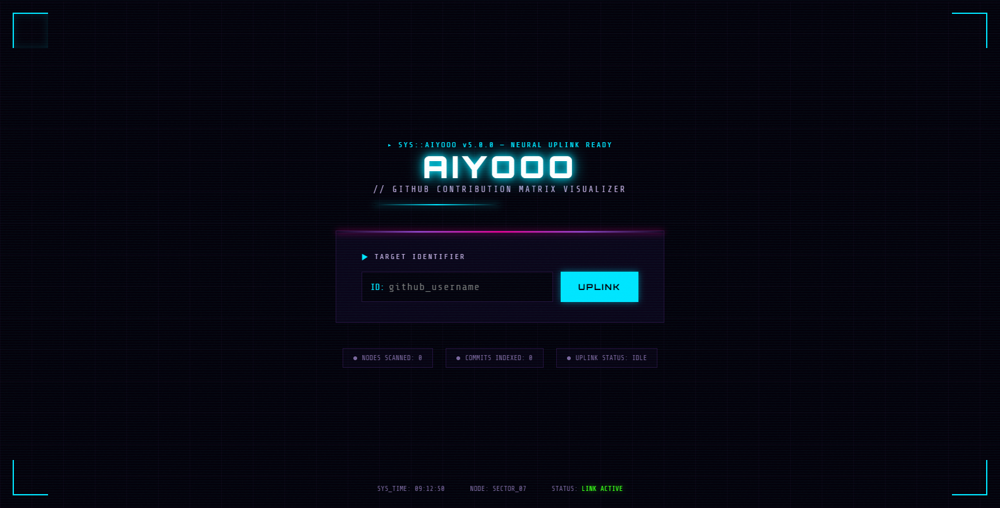
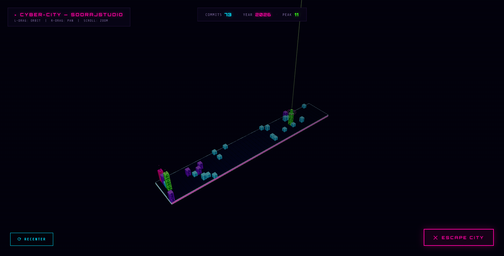

# 🌆 Cyber City — GitHub Contribution Matrix Visualizer

<div align="center">

[](https://threejs.org/)
[](https://react.dev/)
[](https://vitejs.dev/)
[](https://www.typescriptlang.org/)
[](LICENSE)

An interactive cyberpunk WebGL experience that transforms any GitHub user's commit history into a futuristic 3D skyscraper metropolis with synthwave audio.

<br/>



</div>

---

## 📸 Previews

| Neural Uplink Terminal | Contribution Matrix & Heatmap |
| :---: | :---: |
|  |  |
| **Cyberpunk HUD Target Identifier** | **Mined Commits & Activity Matrix** |

| 3D Procedural Skyline | Interactive Inspection |
| :---: | :---: |
|  |  |
| **Commit-Generated Skyscrapers** | **Full 360° Orbit & Zoom** |

---

## ✨ Features

- 🏙️ **Procedural 3D City Generation**: Each commit date is rendered as a neon skyscraper whose height and glow represent commit volume.
- ⚡ **Live GitHub API Uplink**: Enter any public GitHub username to generate their contribution metropolis in real time.
- 🎶 **Integrated Cyber Synth Audio**: Built-in soundtrack player streaming cyberpunk and synthwave tracks.
- 🎮 **Full 3D Orbit & Pan**: Orbit, pan, and zoom around the city grid using intuitive camera controls.
- 📊 **Developer Analytics**: Visualizes total commits mined, active streaks, peak days, and weekly averages.

---

## 🎮 Controls

| Action | Control |
| :--- | :--- |
| **Orbit City** | Left-click and drag across the viewport |
| **Pan Camera** | Right-click and drag |
| **Zoom View** | Mouse wheel or trackpad scroll |
| **Recenter Camera** | Click the **`⟳ RECENTER`** HUD button |
| **Audio Controls** | Play, pause, or switch tracks in the top-right audio pill |

---

## 🚀 How to Run

1. **Install Dependencies**:
   ```bash
   npm install
   ```
2. **Start Dev Server**:
   ```bash
   npm run dev
   ```
   Then open [`http://localhost:5173`](http://localhost:5173) in your browser.
3. **Build for Production**:
   ```bash
   npm run build
   ```

---

## 📄 License

MIT License © 2026 [Sooraj Studio](https://github.com/soorajstudio)
